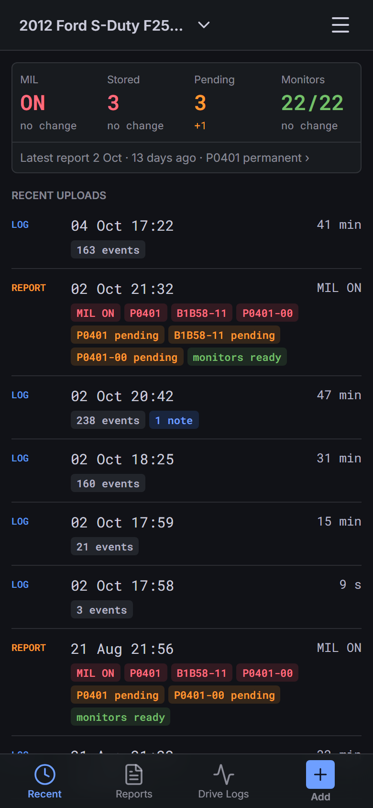
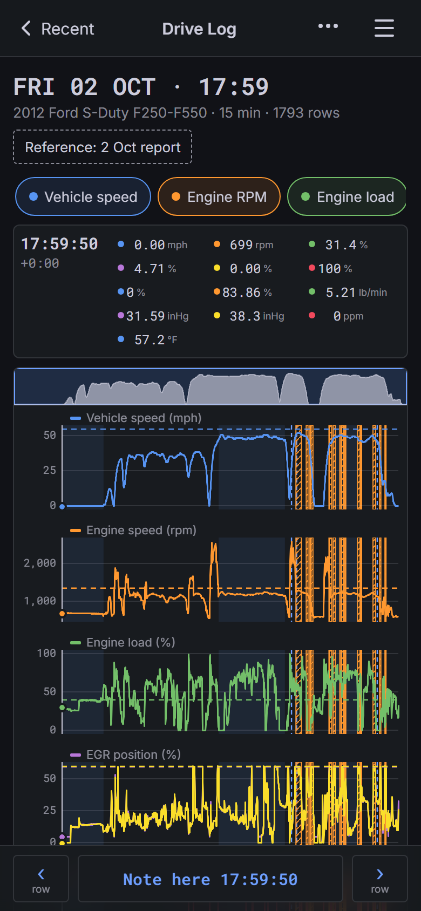
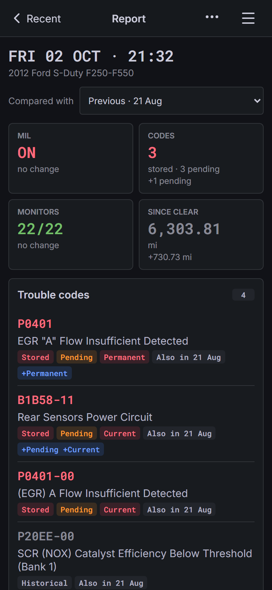
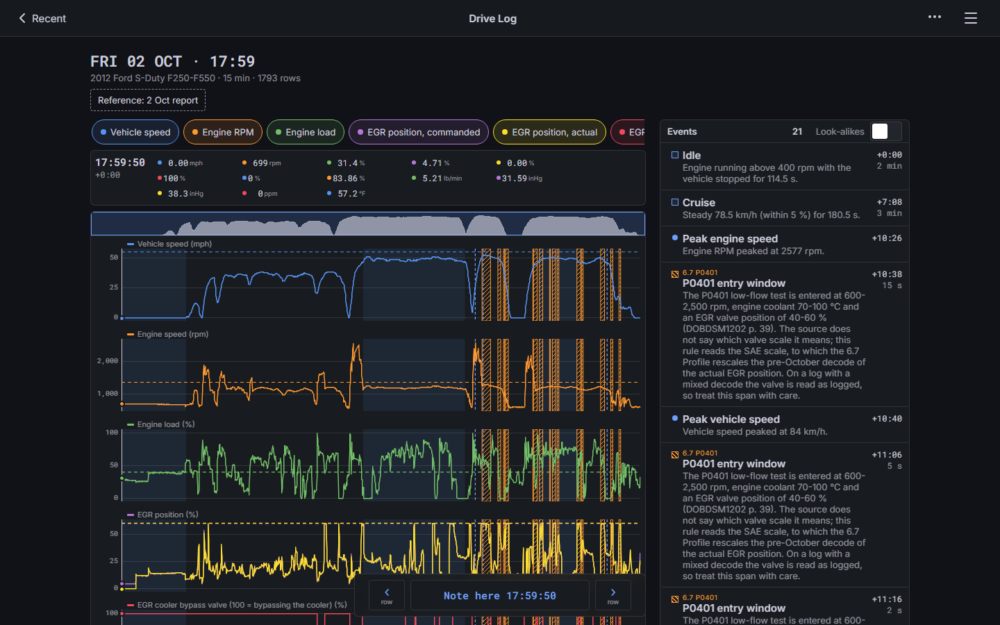

# OBD Garage

OBD Garage is a self-hosted web app for your phone. It shows the files that an OBDLink adapter exports:
**Diagnostic Reports** (HTML) and **drive logs** (CSV). It runs as one Docker container.

The first target is a 2012 Ford F-250 6.7L Power Stroke with a P0401 (EGR flow insufficient) fault. The
design lets it grow to other vehicles and other logged PIDs.

<p align="center">
  
  
  
</p>

<p align="center">
  
</p>

The screenshots use the scrubbed sample files in [test/fixtures/](test/fixtures/).

## What it does

- **Reads OBDLink exports as they are.** Upload a Diagnostic Report or a drive log from the phone. The app
  keeps the original file and finds the vehicle from the VIN in the report.
- **Recent status at a glance.** MIL, stored and pending codes and readiness monitors, each with the change
  since the last report.
- **Report viewer.** Trouble codes and monitors, compared with any earlier report.
- **Drive Log viewer.** Stacked, synced charts with a channel picker, touch zoom and a live cursor.
- **Events.** Rule-based events mark idle, cruise, peaks and vehicle-specific windows (for example the 6.7
  P0401 entry window). They need no LLM.
- **Notes.** Add notes to a drive log, pinned to a moment in the log or not.
- **Export.** Download your files and data as a ZIP.

> **Warning: OBD Garage has no built-in login.** Anyone who can reach the app can read and delete your
> data. Run it behind a reverse proxy that does the authentication. Do not publish the app port to the
> internet. See [docs/deployment.md](docs/deployment.md).

## Project state

v0.1 is out. See the [releases](https://github.com/laszlo462/obd-garage/releases) and
[CHANGELOG.md](CHANGELOG.md) for what changed. The planned work is in the
[open issues](https://github.com/laszlo462/obd-garage/issues). The decisions behind v0.1 are in the closed
[v0.1 wayfinder map](https://github.com/laszlo462/obd-garage/issues/1) and in [docs/adr/](docs/adr/).

## About this project

This project is vibe-coded. An AI assistant (Claude) writes most of the code and the docs. A human owner
sets the direction and reviews the work. The tests and the CI checks are there to catch mistakes. Read the
code before you trust it with data that matters.

## Quick start

Save this as `compose.yaml`:

```yaml
services:
  obd-garage:
    image: ghcr.io/laszlo462/obd-garage:latest
    environment:
      - PUID=1000
      - PGID=1000
    volumes:
      - ./data:/data
    ports:
      - 127.0.0.1:8080:8080
    restart: unless-stopped
```

Then run `docker compose up -d` and open <http://localhost:8080>. The `:develop` tag follows the `main`
branch. The `:latest` tag follows the newest release.

For a real install, with a reverse proxy and authentication, use the
[deployment guide](docs/deployment.md) and the example in [deploy/](deploy/).

## Development

You need Node 24 (see `.node-version`).

```sh
npm ci
npm run dev        # start the dev loop
npm run typecheck  # tsc --noEmit
npm run lint       # Biome
npm test           # Vitest
npm run build      # build the web client
```

See [CONTRIBUTING.md](CONTRIBUTING.md) before you open a pull request. See [DESIGN.md](DESIGN.md) for the
UI design and [GLOSSARY.md](GLOSSARY.md) for the domain terms.

## Licence

[MIT](LICENSE)
